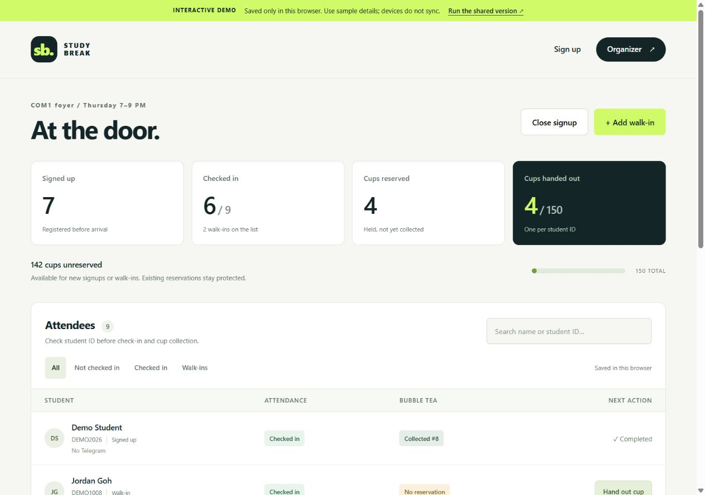

# Study Break Night

Phone-friendly student signup, organizer check-in, and 150 bubble tea cups that cannot be overbooked.

[Open the browser demo](https://ngcanhh.github.io/CheckinComp/) · [Part 1: Telegram reply](docs/telegram-reply.md) · [Deploy the shared app](docs/deploy.md)

**The GitHub Pages demo saves data only in this browser. It does not synchronize across devices and does not send Telegram messages. Use sample details.** The full server implementation is included; shared public hosting and a real Telegram bot still need the account setup below.



[Phone signup](docs/screenshots/mobile-signup.jpg) · [Phone confirmation](docs/screenshots/mobile-confirmation.jpg) · [Phone organizer desk](docs/screenshots/mobile-organizer.jpg)

## What it does

- Students sign up with full name, student ID and optional Telegram handle. IDs are normalized and unique.
- The first available cup is reserved atomically with each signup, up to 150 allocated cups in total. Later signups can still attend, with a clear “No cup reserved” confirmation.
- The confirmation page thanks the student and shows event details and their cup status.
- Organizers sign in, open/close signup, search the attendee list, add walk-ins, check students in and record cup collection separately.
- The organizer list shows registration vs walk-in, Telegram handle, attendance, and reserved/collected/no-reservation status.
- One or two organizer devices can use the shared backend. The list refreshes every five seconds; actions always recheck the database.
- An optional Telegram bot sends confirmation after the attendee opens the linked bot and presses Start. A typed handle alone cannot enable DMs.

The English interface currently uses **Thursday, 7–9 PM, COM1 foyer**. The exact calendar date remains visibly pending. Edit `EVENT` in `public/domain.js` when it is confirmed.

## The 150-cup policy

| Situation | Attendance | Bubble tea |
| --- | --- | --- |
| Signup while cups are available | Added to the list | One cup reserved |
| Signup after all cups are allocated | Still added | No cup reserved |
| Walk-in | Organizer can add and check in | May collect only an unreserved cup |
| Repeat signup with the same student ID | Rejected as duplicate | No second allocation |
| Repeat check-in / collection tap | Original action retained | No second collection |
| All 150 allocated | Check-in continues | New claims are blocked |

Reserved means **held but not collected**. `reserved + collected + unreserved = 150`. A walk-in who collects an unreserved cup reduces what later signups can reserve. Existing reservations are never taken away. No-shows retain their cups until the event ends; there is no automatic release or waitlist promotion.

The database contains exactly 150 numbered slots. An insert trigger reserves a slot in the same statement as a registration. A guarded SQL update records collection once. The cap lives in the database, so two devices cannot bypass it with stale screens or double taps. Organizers should physically check student ID; entering an ID online does not prove eligibility.

## Run the shared version

Install **Node.js 24 or newer**. There are no application dependencies and no install or build step.

```sh
node server/index.mjs
```

Open `http://127.0.0.1:3000`. On first start, a random organizer password is saved to **`data/organizer-key.txt`**. Read that local file to sign in; do not upload it. The SQLite database is stored in `data/event.sqlite` and survives a server restart.

Optional configuration: copy `.env.example` to `.env`, fill in your values, then start with:

```sh
node --env-file-if-exists=.env server/index.mjs
```

For a two-device LAN test, set `HOST=0.0.0.0`, keep the server running, and open its LAN address on both phones on the same trusted network. For real student signups, deploy the HTTPS Cloudflare version; the local loopback URL cannot be opened on another phone. `NODE_ENV=production` requires an explicit `ADMIN_PASSWORD`. Reverse-proxy deployments should use the Worker or adapt the Node transport for trusted HTTPS/proxy information.

**Free shared hosting:** follow [the Cloudflare Workers + D1 guide](docs/deploy.md). It serves the same frontend and API from one origin, with a persistent shared database. Cloudflare account authorization is required; no Cloudflare account was available during implementation. The GitHub Pages link is the deployed review demo, not a shared production event database.

## Try the demo

1. Open the Pages link and sign up using a fictitious student name and ID.
2. Open **Organizer → Open demo organizer**. No password is needed in this explicit local demo.
3. Check the student in, then choose **Hand out cup**. Confirm the separate counters change.
4. Add a walk-in and test **Close signup**. Check-in remains available.
5. **Load sample attendees** on an empty demo for a populated dashboard. **Reset demo** clears only this browser's demo records.

Demo mode is selected explicitly by the Pages deployment configuration. The real frontend does **not** silently switch to local storage if its backend goes offline. A connection warning disables door actions while the shared list is stale.

## Why this setup

Vanilla HTML/CSS/JavaScript keeps the phone UI quick, with no build tool or network fonts. Node's built-in SQLite runs the whole application locally without dependency installation. The same HTTP handler and SQL schema also run on Cloudflare Workers + D1 for shared, persistent hosting. GitHub Pages provides an immediately reviewable static demonstration; its single-browser limitation is shown on screen.

I prioritized a quick door workflow, duplicate prevention, clear reservations and truthful delivery states. I cut the stamp rally, QR scanning, reminders, cancellation, automatic no-show release, and a wider role system. Those need additional rules or credentials and are not needed for the minimum event flow.

Organizer APIs require a server-checked, random session cookie (HttpOnly, SameSite, 12-hour lifetime; Secure on HTTPS). Session tokens are hashed in storage. Password attempts are limited atomically. Anonymous endpoints never return the attendee list. Secrets and the local database are excluded from Git. All user-provided strings are escaped in the interface.

## Telegram

A user must initiate a conversation with a bot first. After signup, a configured app offers a random, 24-hour Telegram Start link. The webhook verifies its secret, links the private chat and sends the confirmation with event details and reservation status. Confirmation jobs persist, successful sends are deduplicated, and failed sends return an error so Telegram can retry. As with many external messaging APIs, a timeout after an accepted send can cause a duplicate on retry; exactly-once delivery is not guaranteed.

**Current status:** no live bot token was supplied. The application honestly displays “Telegram isn’t connected yet”; it never pretends a message was sent. The webhook/send logic is covered by mocked API integration tests, but real Telegram delivery has not been tested. [Setup instructions](docs/deploy.md#4-connect-telegram-optional).

## Validation

```sh
node --test tests/*.test.mjs
```

13 integration tests cover:

- 151 concurrent signups → exactly 150 distinct reservations.
- Walk-in collection followed by later registrations → no overbooking.
- Two organizer sessions collecting one reserved cup → one collection.
- Signup closure, continued attendance, duplicate IDs and duplicate walk-ins.
- Authentication, cross-origin write rejection, concurrent login throttling, and spoofed client-IP protection in the Worker adapter.
- Unconfigured Telegram, secret checks, expired Start links, send deduplication and delivery retry.

Phone UI smoke-tested at a 390px viewport: signup, confirmation, organizer login, check-in, cup collection and walk-in entry. The deployed Pages demo is checked separately before delivery. Cloudflare D1 hosting and live Telegram delivery require user setup and are not claimed as verified.

## What could break at 7 PM

- **Internet/server outage:** shared check-in needs connectivity. There is no offline queue. The last list is retained on screen and door actions are disabled after loss of freshness; keep a manual fallback at the door and reconcile before resuming cup claims.
- **Fake or mistyped IDs:** uniqueness prevents accidental duplicates, not impersonation. Staff must check actual student ID.
- **No-shows:** their reservations remain held. A release policy would need organizer agreement before implementation.
- **Hosting limits:** Cloudflare free tiers have quotas; inspect usage before a real event. A Node deployment needs a persistent disk and database backups.
- **Data retention:** student names/IDs/handles are personal information. Only organizers can read the shared list, but retention/deletion is an operational responsibility. The public demo is for fictitious details only.
- **Telegram:** delivery depends on a public HTTPS webhook, correct secrets, the user pressing Start, and Telegram availability. Registration remains valid if messaging fails.

## Files

```text
public/             Phone UI and explicit browser demo
server/app.mjs      Shared Web Request/Response API
server/index.mjs    Node HTTP + SQLite host
server/sqlite.mjs   Local D1-compatible database adapter
worker.mjs          Cloudflare Worker + static assets adapter
migrations/         Schema and atomic reservation trigger
wrangler.toml       Cloudflare binding configuration
tests/              Integration tests
docs/               Submission reply and deployment guide
.github/workflows/  Checks and Pages demo publication
```

## AI note

AI assisted with requirements clarification, UI design, implementation, documentation and test creation. Automated tests were run against the actual SQLite backend and Worker adapter; browser checks used sample data. The applicant should read and run the project and explain the reservation invariant and demo/production distinction before submission. No claim is made that live bot delivery or a Cloudflare deployment has been completed.

## References

[GitHub Pages hosts static files](https://docs.github.com/en/pages/getting-started-with-github-pages/what-is-github-pages), [Cloudflare D1 setup](https://developers.cloudflare.com/d1/get-started/), [Worker static assets](https://developers.cloudflare.com/workers/static-assets/binding/), and [Telegram bot limitations](https://core.telegram.org/bots#how-are-bots-different-from-humans).
