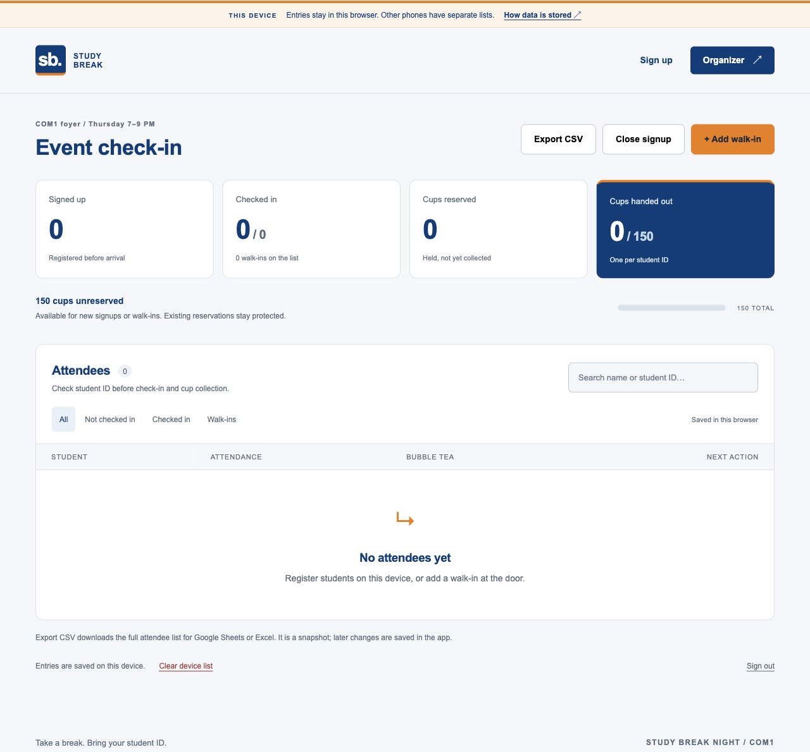

# Study Break Night

Phone-friendly event registration, organizer check-in and a limit of 150 bubble tea cups.

**[Open the live website →](https://ngcanhh.github.io/CheckinComp/)**

[Organizer desk](https://ngcanhh.github.io/CheckinComp/#organizer) · [Reply to the wing](docs/telegram-reply.md) · [Hosting guide](docs/deploy.md)

The published website saves entries in the current browser and starts with **no preloaded students**. Use one phone/browser as the event desk. Other phones have separate lists and cup totals. The repository also contains a shared backend, which requires the optional Cloudflare deployment.



[Phone registration](docs/screenshots/phone-signup.jpg) · [Phone organizer desk](docs/screenshots/phone-organizer.jpg)

## Use the live website

1. Open the website on the phone managing the event. No installation is needed.
2. Register a student using full name, student ID and optional Telegram username. Registration reserves one available cup; the confirmation shows the event details and reservation status.
3. Choose **Organizer → Open organizer desk**. In this device-storage version there is no password; anyone using that browser can access its list.
4. Search for the student, check their physical ID, tap **Check in**, then **Hand out cup** when they collect it. Attendance and collection are separate.
5. Use **+ Add walk-in** for an unregistered arrival. Walk-ins may collect only unreserved stock.
6. Use **Close signup** to stop registration. Check-in and walk-ins can continue.
7. Choose **Export CSV** to download the complete list for Google Sheets or Excel.

There is no sample-student loader. Upgrading removes the eight identifiable student fixtures from the older release while retaining manually entered records. **Clear device list** deletes entries in this browser after confirmation; export first if you need a copy.

The event currently says **Thursday, 7–9 PM, COM1 foyer**, Singapore time. The exact date is visibly pending confirmation. Update `EVENT` in `public/domain.js` when confirmed.

## Data storage

| Version | Storage | Shared between phones? | Organizer access |
| --- | --- | --- | --- |
| Live GitHub Pages website | Browser local storage | No | Open on that browser |
| Local Node server | `data/event.sqlite` on the host computer | Yes, if devices can reach the server | Password |
| Cloudflare Worker + D1 | Hosted persistent database | Yes | Password |

The published version follows the brief's allowance for storing data on one phone. It needs no backend account and is free to host. Reloading retains entries, but clearing browser data, private browsing, switching browsers or changing phones can lose or separate the list. Do not collect independent registrations on multiple phones and expect one global 150-cup total.

The shared backend uses database constraints and atomic updates to prevent double allocation across devices. It does not silently switch to browser storage when offline. This backend is included in the source; it is not hosted by the GitHub Pages link.

### Google Sheets and Excel

**Export CSV** includes name, student ID, Telegram username, entry type, attendance, cup number/status and Singapore timestamps. Export always includes the full list, regardless of search and filters. UTF-8 preserves Vietnamese names; spreadsheet formula prefixes in user input are escaped.

In Google Sheets, choose **File → Import → Upload** and select the downloaded CSV. Excel can open it or import it as UTF-8. CSV is a snapshot: later app changes require another export. Automatic Google Sheets synchronization is not configured.

## The 150-cup rule

`reserved + collected + unreserved = 150`

- Registration reserves one available cup. When all cups are allocated, students can still register with a clear **No cup reserved** confirmation.
- One normalized student ID has one entry and at most one cup.
- Check-in does not itself record collection. Repeated taps do not record a second check-in or collection.
- Walk-ins use only unreserved stock; existing reservations stay protected.
- No-show reservations remain held until event end. There is no automatic release or waitlist promotion.

On Pages this rule applies to the current browser's list. Supported browsers use Web Locks to serialize same-origin tabs; use a single event tab on browsers without Web Locks. In shared mode, SQLite/D1 enforces the rule with 150 numbered slots, an allocation trigger and a guarded collection update.

## Interface

NUS-inspired blue `#003D7C` and orange `#EF7C00`, ordinary Arial/Helvetica, no external fonts. Phone layouts use attendee cards, large tap targets and 16px form inputs. The site uses its own Study Break identity rather than the NUS logo. Screenshots show the current interface with an empty attendee list.

## Run locally

Install **Node.js 24 or newer**. No application dependencies, install step or build are needed.

```sh
npm start
```

Open `http://127.0.0.1:3000` on that computer. Find the organizer password in `data/organizer-key.txt`; keep it private. The database in `data/event.sqlite` survives restarts. An optional local `.env` is read by `npm start`.

For a phone on the same trusted Wi-Fi:

```sh
HOST=0.0.0.0 npm start
```

Open `http://YOUR-COMPUTER-LAN-IP:3000` on the phone. Keep the computer awake and the server running. A phone's `127.0.0.1` points to itself, not the computer. For a public shared list, follow the [Cloudflare guide](docs/deploy.md#shared-hosting-cloudflare-workers--d1).

## Publish updates

The [Pages workflow](.github/workflows/pages.yml) publishes from `codex/event-checkin` or `main`. It runs checks and tests, copies all frontend modules including CSV export, and sets `mode: "browser"` in the Pages artifact. Local Node/Worker deployments keep `mode: "server"`.

Push edits and wait for **Publish Study Break Night** in GitHub Actions. The live website and organizer links are at the top of this README. Never upload `data/`, `.env`, organizer passwords or bot tokens.

## Telegram

Telegram is **not connected on the public website**. A username alone cannot enable DMs. The confirmation explicitly says that no message was sent.

The shared backend includes an optional bot integration, requiring a bot token, webhook secret, HTTPS endpoint and the student opening the bot and pressing **Start**. Mocked tests cover this integration; real delivery is not claimed. See [setup instructions](docs/deploy.md#4-connect-telegram-optional).

## Validation and what can break

```sh
npm run check
npm test
```

Tests cover empty browser startup, fixture cleanup with manually entered records retained, duplicate IDs, 151 signups against the 150-cup limit, walk-ins, check-in/collection, shared database races, signup closure, authentication, Worker transport, Telegram retries, and CSV encoding/formula protection.

- **Separate phones:** Pages does not share data or enforce a global cup cap across devices. Use one desk device or deploy the shared backend.
- **Storage loss:** clearing site data removes the local list. There is no restore/import feature; export regularly.
- **Phone access:** the device-storage version has no organizer password. Use a trusted event device. Shared mode has server-verified sessions and private attendee endpoints.
- **Outage:** initial loading needs connectivity. Shared mode also needs a reachable server for changes; stale data disables door actions and there is no offline queue.
- **Student eligibility:** unique IDs do not prove identity. Staff should check physical student ID.
- **Configuration:** confirm the date before the event. Optional shared hosting and real Telegram delivery need setup; free hosting tiers have quotas.

## Files

```text
public/             Mobile UI, browser storage and CSV export
server/             Shared API, SQLite host and optional Telegram setup
worker.mjs          Cloudflare Worker adapter
migrations/         Database schema and 150-cup allocation rules
tests/              Browser, API, Worker and CSV tests
docs/               Reply, hosting guide and current screenshots
.github/workflows/  Automated checks and Pages publication
```

AI assisted with implementation, design and tests. The live storage choice and limitations are documented above; optional integrations are not presented as active features.

References: [GitHub Pages](https://docs.github.com/en/pages/getting-started-with-github-pages/what-is-github-pages), [NUS colours](https://www.nus.edu.sg/identity/guidelines/corporate-colours), [Cloudflare D1](https://developers.cloudflare.com/d1/get-started/), [Telegram limitations](https://core.telegram.org/bots#how-are-bots-different-from-humans).
